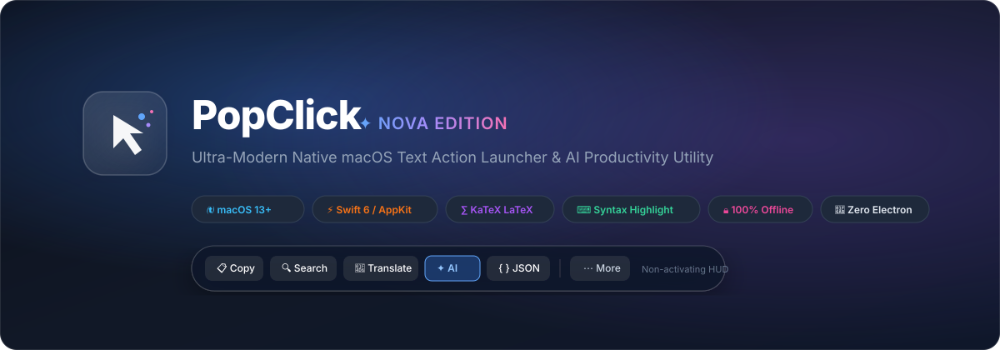
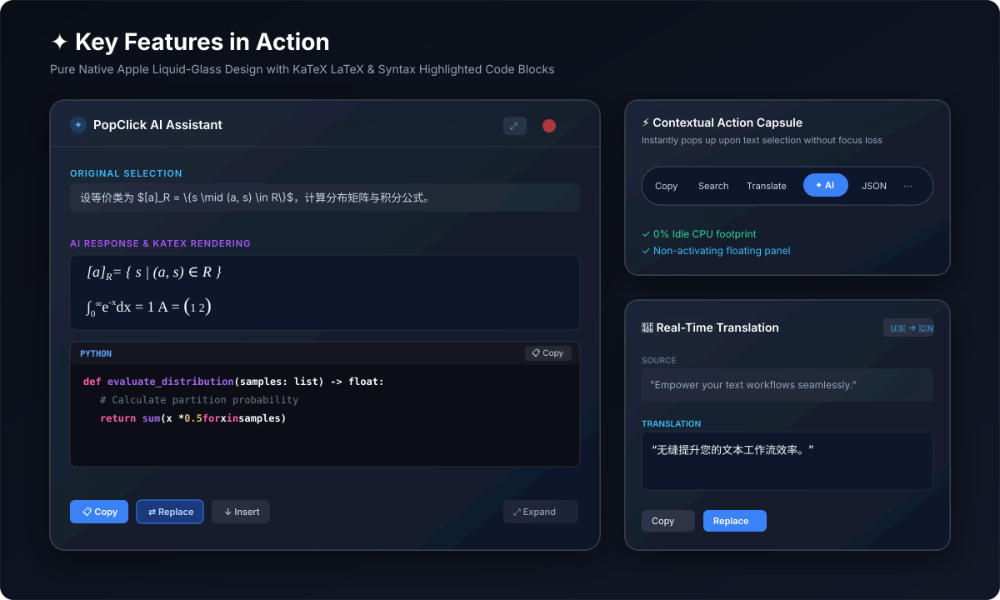
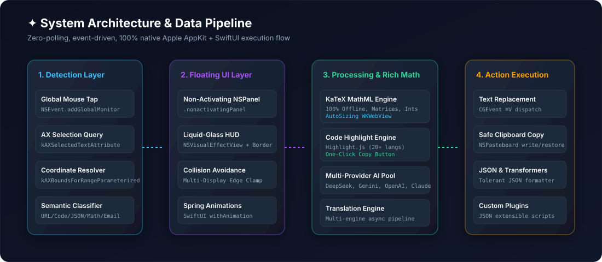

<div align="center">



# ✦ PopClick

**The Ultra-Modern, High-Performance macOS Text Action Launcher & AI Productivity Assistant.**  
*Handcrafted with native Swift 6, AppKit, SwiftUI & 100% Offline KaTeX LaTeX.*

[English](README.md) • [简体中文](README_CN.md) • [Features](#-key-features) • [Architecture](#-architecture) • [Build & Run](#-build--run)

<p align="center">
  
  
  
  
  
  
  
</p>

</div>

---

## 🌟 Overview

**PopClick** elevates mouse text selection across **any** macOS application into an immediate, fluid, and delightful productivity experience. Select text in Safari, Xcode, Terminal, Notion, Slack, or Preview, and a refined Apple liquid-glass capsule pops up instantly next to your cursor.

### 💎 Design Philosophy
- **Zero Pollution & Zero Polling**: Relies exclusively on `NSEvent.addGlobalMonitorForEvents` and macOS Accessibility APIs. **0% idle CPU footprint**, zero battery drain.
- **Non-Activating HUD Panels**: Powered by AppKit's `.nonactivatingPanel`. Interacting with PopClick will **never** steal application focus or dismiss your active text selection.
- **100% Offline KaTeX & Code Engine**: Complex mathematical formulas, scientific papers, matrices, fractions, and multi-language code snippets render natively inside PopClick with zero network latency or remote CDN dependencies.

---

## 📸 Visual Showcase

<div align="center">



</div>

---

## 🚀 Key Features

### 1. ⚡ Context-Aware Floating Action Capsule
- **Dynamic Semantics**: Analyzes selected text in real-time to surface optimal actions:
  - **Plain Text**: `Copy`, `Search`, `Translate`, `AI`, `More (⋯)`
  - **Code & JSON**: `Copy`, `Format JSON`, `AI`, `More (⋯)`
  - **URLs**: `Open URL`, `Copy`, `Share`, `AI`, `More (⋯)`
  - **Emails**: `Email`, `Copy`, `AI`, `More (⋯)`
- **Native Liquid-Glass Material**: True macOS Sequoia/Tahoe specular border highlights, vibrancy blur, and SF Pro typography.
- **Intelligent Collision Avoidance**: Automatically calculates screen edges, dock, and menu bar boundaries to flip and position smoothly on multi-display setups.

### 2. 🤖 Intelligent AI Assistant & Enlarged Reader View
- **Multi-Model Provider Pool**: Built-in support for **DeepSeek**, **Google Gemini**, **OpenAI (GPT-4o)**, **Anthropic Claude**, and local **Ollama** (offline LLMs).
- **Enlarged Reading Canvas**:
  - **Standard Mode (580px × 480px)**: 2.1x larger default reading viewport so formulas and paragraphs never feel cramped.
  - **Expanded Mode (760px × 680px)**: One-click expansion into a spacious reader window for long-form essays, research papers, and complex code.
  - **Persistent Preferences**: Remembers your preferred window size automatically.
  - **Edge-Resizable**: Borderless resizable panel allows custom window dragging.
- **Direct Output Actions**: One-click `Copy`, `Replace Selection` (via synthesized ⌘V), or `Insert After`.

### 3. ∑ 100% Offline KaTeX LaTeX Mathematical Typesetting
- **Academic-Grade Typography**: Renders LaTeX math expressions natively with full Apple subpixel anti-aliasing.
- **Comprehensive Math Support**:
  - **Equivalence Classes & Sets**: `$[a]_R = \{s \mid (a, s) \in R\}$`
  - **Matrices & Arrays**: `\begin{pmatrix} 1 & 2 \\ 3 & 4 \end{pmatrix}`
  - **Fractions & Radicals**: `\frac{2}{3}`, `\sqrt[n]{x}`
  - **Calculus & Integrals**: `$$\int_0^\infty e^{-x} dx = 1$$`
  - **Subscripts & Superscripts**: Crisp, balanced KaTeX font rendering.
- **Marked + KaTeX Protection**: Pre-processes LaTeX commands before Markdown parsing so underscores (`_`) and column delimiters (`&`) are never mangled.

### 4. ⌨ Code Blocks with Syntax Highlighting & One-Click Copy
- **Offline Highlight.js Integration**: Full syntax highlighting for 20+ languages including Swift, Python, JavaScript, TypeScript, Bash, JSON, C++, Rust, Go, SQL, and HTML.
- **Header Bar & Language Badge**: Displays detected language tag with monospace badge.
- **One-Click Code Copy**: Dedicated copy button in the code header (`📋 Copy` → `✓ Copied!`) with native macOS clipboard fallback.
- **Light & Dark Theme Harmonization**: Automatic color scheme adaptation inspired by Apple Xcode.

### 5. 📖 Real-Time Multi-Language Translation
- Instant dual-language translation panel with automatic source language detection.
- Expanded reading mode supporting up to 640px width and 460px height.
- Direct copy or replace with translated text in frontmost application.

### 6. 🔧 Smart Text Utilities & Tolerant JSON Formatter
- **Format JSON**: Fault-tolerant JSON formatter that fixes unquoted JavaScript keys (`{name: "John"}`), single quotes (`{'key': 'val'}`), Python literals (`True`, `False`, `None`), trailing commas, and escaped strings, while preserving forward slashes in URLs (`https://...`).
- **Text Case Conversions**: `UPPERCASE`, `lowercase`, `Title Case`.
- **String Sanitization**: `Remove Line Breaks (Unwrap)`, `Trim Whitespace`.
- **Encoding Tools**: `Base64 Encode/Decode`, `URL Percent Encode/Decode`.

### 7. 🧩 Extensible JSON Plugin Architecture
- Easily add custom search engines, web actions, and shell scripts via simple JSON configurations saved in `~/Library/Application Support/PopClick/Plugins`.

---

## 🏗️ Architecture

<div align="center">



</div>

### Technology Stack
| Component | Technology | Description |
| :--- | :--- | :--- |
| **Language** | Swift 6.0 | Strict concurrency, ARC memory safety, zero C bridge leaks |
| **UI Framework** | AppKit + SwiftUI | Borderless `NSPanel` (`.nonactivatingPanel`) + SwiftUI Views |
| **Event System** | Quartz Event Services | `NSEvent.addGlobalMonitorForEvents` (0% idle CPU) |
| **Accessibility** | macOS AXUIElement | Sub-millisecond text extraction & selection coordinate conversion |
| **Math Engine** | KaTeX 0.19.1 | Bundled local WOFF/WOFF2 fonts & JS (100% offline) |
| **Code Highlighting**| Highlight.js 11.9.0 | Local syntax highlighting with Xcode light/dark styling |
| **Markdown** | Marked 18.2.0 | GFM-compliant offline parser |
| **Deployment** | macOS 13.0+ (Ventura, Sonoma, Sequoia) | Native Apple Silicon (arm64) & Intel (x86_64) |

---

## 🛠️ Build & Run

### Prerequisites
- macOS 13.0 or later
- Xcode 15+ or Swift 6 Command Line Tools (`xcode-select --install`)

### One-Command Build
Clone the repository and run the automated native build script:

```bash
# Clone repository
git clone https://github.com/bin158/popclick.git
cd popclick/PopClick

# Build native .app bundle
bash build.sh
```

### Launch PopClick
```bash
# Open application
open .build/direct/PopClick.app
```

> **Note on Permissions**: On first launch, macOS will request **Accessibility** permissions (`System Settings -> Privacy & Security -> Accessibility`). This is strictly required to detect selected text coordinates and paste replacements.

---

## 🔒 Privacy & Security

- **100% Local by Default**: Text selection, coordinate calculation, KaTeX math typesetting, code highlighting, and string transformations execute **entirely offline** on your local machine.
- **Zero Telemetry**: PopClick contains **no analytics, no trackers, and no background phone-home telemetry**.
- **Secure API Storage**: Your AI API keys (OpenAI, Gemini, Claude, DeepSeek) are stored exclusively in your local macOS user defaults/keychain and are never transmitted to third parties other than the respective official AI API endpoints you configure.

---

## 📄 License

PopClick is licensed under the **MIT License**. See [LICENSE](LICENSE) for details.

---

<div align="center">
  <sub>Crafted with passion for macOS power users.</sub>
</div>
