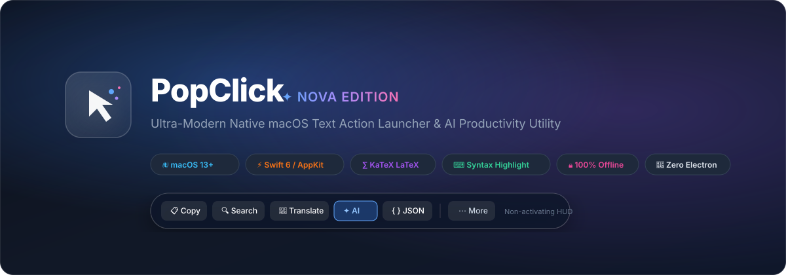
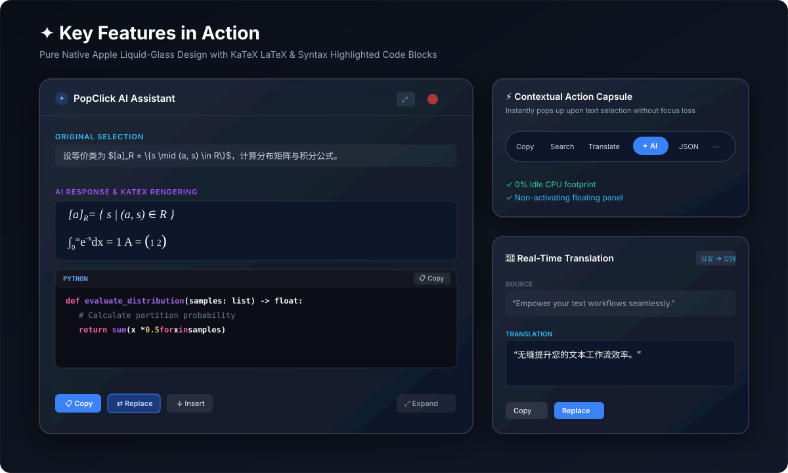
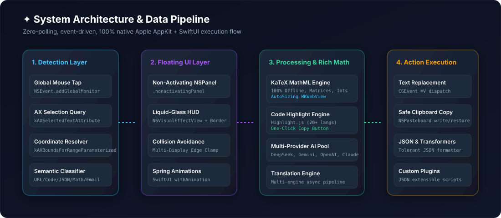

<div align="center">



# ✦ PopClick

**专为 macOS 打造的高性能现代划词工具栏与 AI 效率助手。**  
*采用 Swift 6、AppKit、SwiftUI 与纯离线 KaTeX 专业排版引擎精工打造。*

[English](README.md) • [简体中文](README_CN.md) • [核心特性](#-核心特性) • [技术架构](#-系统架构) • [编译与运行](#-编译与安装)

<p align="center">
  
  
  
  
  
  
  
</p>

</div>

---

## 🌟 简介与产品理念

**PopClick** 将 macOS 上任意应用中的文本划词选择升华成为行云流水、赏心悦目的即时生产力。在 Safari、Xcode、终端（Terminal）、Notion、Slack、飞书或 Preview 中选中文本，鼠标旁立刻浮现晶莹剔透的 Apple 原生流体玻璃药丸工具栏。

### 💎 核心准则
- **零轮询 & 零背景消耗**：完全依赖 macOS 事件监听机制与辅助功能（Accessibility API），**闲置 CPU 占用率 0%**，无多余耗电。
- **非激活窗口（Non-Activating Panel）**：依托底层 `NSPanel(.nonactivatingPanel)` 实现，在工具栏上点击任何按钮**绝不抢占前台应用焦点**，更不会导致选中的高亮文本丢失。
- **100% 离线数学公式与代码引擎**：无需网络连接或远程 CDN，复杂 LaTeX 科学公式、矩阵、积分、分式与多语言代码块全部内置本地排版，即开即显。

---

## 📸 功能图览

<div align="center">



</div>

---

## 🚀 核心特性

### 1. ⚡ 智能语境感应悬浮工具栏
- **实时语义分类**：划词时自动识别文本类型并推荐最合适的操作：
  - **普通文本**：`复制`、`搜索`、`翻译`、`AI (PopClick AI Agent)`、`更多 (⋯)`
  - **代码**：`复制`、`解释 (Explain)`、`注释 (Comment)`、`修复 (Fix)`、`重构 (Refactor)`、`AI`、`更多 (⋯)`
  - **JSON 文本**：`复制`、`格式化`、`校验 (Validate)`、`解释`、`AI`
  - **SQL 语句**：`复制`、`格式化`、`解释`、`优化 (Optimize)`、`AI`
  - **超链接 URL**：`打开网页`、`复制`、`系统分享`、`AI 总结`、`更多 (⋯)`
  - **电子邮箱**：`撰写邮件`、`复制`、`AI`、`更多 (⋯)`
- **原生液态玻璃材质**：深度融合 macOS 浅色与深色（Dark Mode）外观，呈现高光边框、亚克力模糊与 Apple SF Pro 字阶。
- **防边缘碰撞算法**：自动计算屏幕四周边距、菜单栏与程序坞（Dock）位置，在多显示器环境下智能切换上下布局。

### 2. 🤖 PopClick AI Agent 智能助手与宽屏舒适阅读器
- **多模型服务支持**：开箱即用支持 **Google Gemini**、**DeepSeek**、**OpenAI (GPT-4o)**、**Claude** 以及本地离线运行的 **Ollama**。
- **全套代码智能套件**：代码解释、原生语言注释/文档生成、语法/逻辑修复、重构优化、单测生成、安全审计、以及实时 LCS 代码 Diff 差异对比。
- **倍增阅读空间**：
  - **标准模式（580px × 480px）**：相比传统小弹窗面积提升 **2.1 倍**，告别狭窄挤压感。
  - **放大阅读模式（760px × 680px）**：一键切换大窗口视野，长文解析、学术论文推导与长代码阅读舒适畅快。
  - **记忆偏好设置**：切换放大模式后自动记住您的选择，下次呼出保持大屏视野。
  - **窗口自由缩放**：面板带 `.resizable` 特性，支持拖拽边框自由调整宽高。
- **一键替换与写入**：提供 `复制`、`替换选中代码（Replace Selection，精准替换且不破坏周围逻辑）` 以及 `在后方追加`。

### 3. ∑ 100% 纯离线 KaTeX LaTeX 数学公式渲染
- **专业级科学排版**：本地原生解析渲染，字形完美平滑抗锯齿。
- **全面公式语法覆盖**：
  - **等价类与集合论**：`$[a]_R = \{s \mid (a, s) \in R\}$`
  - **线性代数矩阵**：`\begin{pmatrix} 1 & 2 \\ 3 & 4 \end{pmatrix}`
  - **分式与上下标**：`\frac{2}{3}`、`x_1^2` 具有真实数学排版比例与分数线。
  - **微积分与级数**：`$$\int_0^\infty e^{-x} dx = 1$$`，上下限端正美观。
- **防 Markdown 语法转义**：解析前自动隔离公式内容，矩阵换行符 `\\`、列分隔符 `&` 以及下标 `_` 不会被转义为斜体或 HTML 实体。

### 4. ⌨ 代码块智能高亮与一键复制代码
- **离线 Highlight.js 引擎**：支持 Swift、Python、JS、TS、Bash、JSON、C++、Rust、Go、SQL、HTML 等 20+ 主流编程语言。
- **语言标志顶栏**：代码块头部带有专属语言标签（如 `PYTHON`、`SWIFT`）。
- **一键复制代码按钮**：悬浮于代码块右上角的 `[📋 Copy]` 按钮，点击即复制纯代码内容（带反馈动画 `✓ Copied!`），内置系统剪贴板原生容错机制。
- **Xcode 风格双色调**：浅色模式清新自然，深色模式对比柔和。

### 5. 📖 实时多语言翻译面板
- 选中文本后自动检测源语言并快速翻译。
- 扩容至宽屏视窗（480px / 640px 展开），长段落翻译阅读体验极大提升。
- 支持一键复制翻译结果或直接将原文替换为译文。

### 6. 🔧 高容错 JSON 格式化与文本工具箱
- **宽容型 JSON 格式化器**：支持未加引号的 JS 对象键名（`{name: "John"}`）、单引号字符串（`{'status': 'ok'}`）、Python 布尔字面量（`True`、`False`、`None`）、尾随逗号与转义字符串清理，且不会破坏 URL 斜杠（保留 `https://...`）。
- **大小写快速转换**：`全大写 (UPPER)`、`全小写 (lower)`、`词首大写 (Title Case)`。
- **排版清理**：`去除换行 (Unwrap)`、`修剪前后空白`。
- **编码与解码**：`Base64 编解码`、`URL 编码与解码`。

### 7. 🧩 自定义 JSON 插件体系
- 位于 `~/Library/Application Support/PopClick/Plugins`，编写简单的 JSON 文件即可随心扩展专属网页搜索、脚本工具或快捷指令。

---

## 🏗️ 系统架构

<div align="center">



</div>

### 技术栈选型
| 模块 | 技术选型 | 说明 |
| :--- | :--- | :--- |
| **编程语言** | Swift 6.0 | 严格并发安全检查、ARC 自动引用计数、无 C 桥接内存泄漏 |
| **UI 框架** | AppKit + SwiftUI | 结合了 AppKit 非激活浮层与 SwiftUI 声明式动态交互 |
| **事件拦截** | Quartz Event Services | `NSEvent.addGlobalMonitorForEvents` 极低开销监听 |
| **辅助功能** | macOS AXUIElement | 亚毫秒级精准划词提取与屏幕坐标换算 |
| **数学引擎** | KaTeX 0.19.1 | 离线打包全套 WOFF/WOFF2 字体与 JS 脚本（100% 离线） |
| **代码高亮** | Highlight.js 11.9.0 | 离线语法着色与 Xcode 原生质感配色 |
| **Markdown** | Marked 18.2.0 | GFM 标准离线解析 |
| **运行环境** | macOS 13.0+ | 原生支持 Apple Silicon (M1/M2/M3/M4) 与 Intel 芯片 |

---

## 🛠️ 编译与安装

### 系统要求
- macOS 13.0 (Ventura) 及更高版本（Sonoma / Sequoia）
- Xcode 15+ 或 Swift 6 命令行工具（Terminal 执行 `xcode-select --install`）

### 一键极速编译
克隆本仓库并在项目根目录下执行编译脚本：

```bash
# 克隆仓库
git clone https://github.com/bin158/popclick.git
cd popclick/PopClick

# 执行编译（生成原生 .app 包并完成临时签名）
bash build.sh
```

### 运行应用
```bash
# 启动应用
open .build/direct/PopClick.app
```

> **权限提示**：首次运行时，macOS 会提示授予**辅助功能权限**（`系统设置 -> 隐私与安全性 -> 辅助功能`）。此权限是检测屏幕选中文本与自动粘贴替换所必需的系统接口。

---

## 🔒 隐私与安全性

- **全本地离线处理**：划词提取、公式数学排版、代码语法高亮与文本转换**完全在您的 Mac 本地离线执行**。
- **零遥测与零追踪**：PopClick **没有任何数据埋点、没有遥测脚本、不会在后台偷偷回传任何日志**。
- **安全密钥存储**：您在设置中配置的各大 AI 服务 API Key 仅保存在本地设备中，直接且仅与官方 API 通信，绝无任何中间代理服务器。

---

## 📄 开源协议

本项目采用 **MIT License** 开源。详情请参阅 [LICENSE](LICENSE)。

---

<div align="center">
  <sub>精心为 Mac 效率玩家雕琢。</sub>
</div>
